# System Architecture

```mermaid
flowchart LR
    UCI[UCI Diabetes 130-US Hospitals] --> LAND[Local data/raw landing area]
    LAND --> ING[Python and Pandas ingestion]
    ING --> LOG[Ingestion status and error logs]
    ING --> STAGE[Raw staging CSVs]
    STAGE --> CLEAN[Cleaning and validation]
    CLEAN --> REJECT[Rejected-record log]
    CLEAN --> MART[Curated analytical CSV marts]
    MART --> DB[(PostgreSQL healthcare schema)]
    MART -. local fallback .-> SQLITE[(SQLite development database)]
    DB --> DASH[Streamlit analytics dashboard]
    SQLITE --> DASH
    MART --> FE[Patient-grouped feature preparation]
    FE --> TRAIN[Logistic Regression, Random Forest, XGBoost]
    TRAIN --> MLFLOW[MLflow runs, metrics, artifacts, registry]
    TRAIN --> MODEL[Versioned local model artifact]
    MODEL --> API[FastAPI inference prototype]
    API --> MON[Quality, drift, latency, and failure monitoring]
```

## Layers

| Layer | Project location or service | Contents |
|---|---|---|
| Source | UCI public dataset | De-identified encounter CSV and ID mapping CSV |
| Landing/raw | `data/raw/` | User-downloaded original files; ingestion does not edit them |
| Ingestion | `src/ingestion.py`, Airflow DAG | Repeatable CSV extraction, staging writes, append-only run records |
| Staging | `data/staging/` | Source staging, cleaned staging, validated staging |
| Quality | `src/cleaning.py`, `src/validation.py` | Special-code normalization and invalid/duplicate encounter rejection |
| Transformation | `src/transformation.py` | Patient-safe analytical key, derived fields, normalized marts |
| Storage | `database/schema.sql` | PostgreSQL `hospital` schema; SQLite is a local fallback |
| Analytics | `dashboard/app.py` | Interactive Streamlit views sourced from the analytical table |
| MLOps | `src/train_model.py`, MLflow | Grouped model comparison, evaluation, artifacts, and registry |
| Serving/monitoring | `src/model_api.py`, `src/monitor_data.py` | Local API and batch quality/drift/performance checks |

The UCI data has no department identifier or encounter timestamp. Admission type and primary diagnosis are used for available comparisons; department comparisons and chronological validation are not claimed. The patient-grouped split is used to avoid encounters for a person appearing in both training and test sets.
